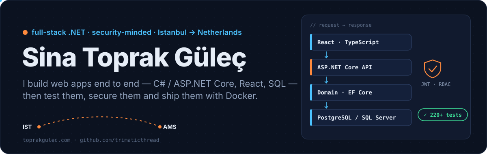
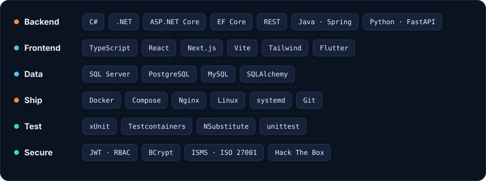
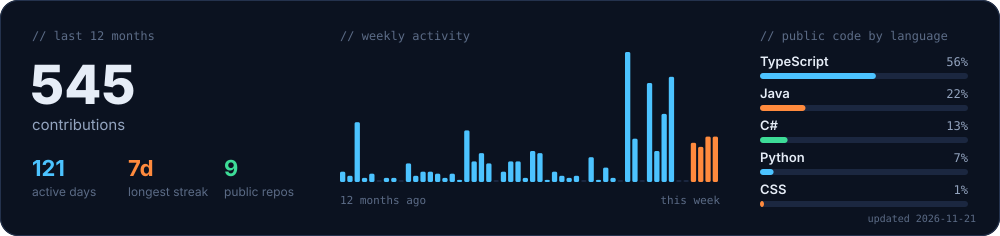
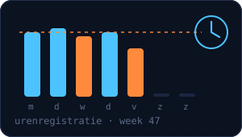
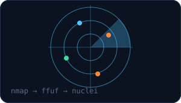
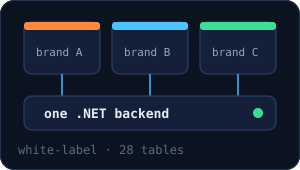
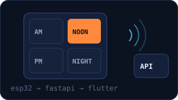
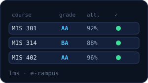

  

  <a href="https://www.toprakgulec.com"><b>Website</b></a> ·
  <a href="https://www.linkedin.com/in/sina-toprak-gulec-26761923b"><b>LinkedIn</b></a> ·
  <a href="mailto:toprakgulec34@gmail.com"><b>Email</b></a>

## About

I'm a final-year Management Information Systems student and a freelance full-stack developer. I like owning a feature from the database schema to the deployed container — and I came to software through information security, so authentication, data protection and server hardening are part of how I build, not an afterthought.

- **.NET on the backend, React on the front:** C# / ASP.NET Core and EF Core, with TypeScript and React for the UI.
- **Tested and shipped:** xUnit and Testcontainers against real databases, Docker and Nginx on Linux servers I set up myself.
- **Security background:** associate degree in Information Security Technology, Hack The Box practice, and [Skopos](https://github.com/trimaticthread/Skopos), my own recon tool.
- **AI-assisted, human-reviewed:** I build with Claude Code and review, debug and own every line that ships.
- **Next:** relocating to the Netherlands and open to junior .NET / full-stack roles.

## Toolkit

  

## Activity

  

## Featured work

<table>
  <tr>
    <td width="320"></td>
    <td>
      <h3><a href="https://github.com/trimaticthread/Klokwerk">Klokwerk</a></h3>
      Multi-tenant time-registration (<i>urenregistratie</i>) app built for a client in the Dutch market — clock in/out, team week grid against contract hours, Excel exports for the accountant. The whole domain is written in Dutch.  
      <code>.NET 10</code> <code>EF Core</code> <code>PostgreSQL</code> <code>React 19</code> <code>TypeScript</code> <code>Docker</code> 
      <b>137 tests</b> · xUnit + Testcontainers · tenant isolation verified
    </td>
  </tr>
  <tr>
    <td width="320"></td>
    <td>
      <h3><a href="https://github.com/trimaticthread/Skopos">Skopos</a></h3>
      Profile-driven reconnaissance orchestrator for pentesters. One command chains nmap, ffuf, nuclei and OSINT sources; results feed each other and land in a local, filterable findings viewer.  
      <code>Python</code> <code>nmap</code> <code>nuclei</code> <code>OSINT</code> 
      <b>Open source</b> · MIT · plugin architecture · no shell execution
    </td>
  </tr>
  <tr>
    <td width="320"></td>
    <td>
      <h3>.NET E-Commerce</h3>
      White-label store where one backend serves several brands. Server-side pricing, an order state machine, oversell-proof stock deduction and a promotion engine.  
      <code>.NET 10</code> <code>PostgreSQL</code> <code>React 19</code> <code>shadcn/ui</code> <code>TanStack Query</code> 
      <b>92+ unit tests</b> · pre-launch product · private, demo on request
    </td>
  </tr>
  <tr>
    <td width="320"></td>
    <td>
      <h3>MediSense</h3>
      IoT medication cabinet: an ESP32 with load cells and locked compartments, a FastAPI backend on a Linux VPS, and a Flutter app with live WebSocket updates for caregivers and patients.  
      <code>ESP32</code> <code>FastAPI</code> <code>PostgreSQL</code> <code>Flutter</code> <code>Nginx</code> 
      <b>38 endpoints + WebSocket</b> · private, demo on request
    </td>
  </tr>
  <tr>
    <td width="320"></td>
    <td>
      <h3>LMS &amp; e-Campus</h3>
      Learning management and e-campus system for universities: curriculum, grading and attendance, with JWT refresh-token rotation and role-based access.  
      <code>.NET 10</code> <code>EF Core</code> <code>SQL Server</code> <code>React</code> <code>TypeScript</code> 
      private, demo on request
    </td>
  </tr>
</table>

Also here: <a href="https://github.com/trimaticthread/IT-Helpdesk">IT-Helpdesk</a> · <a href="https://github.com/trimaticthread/File-Server">File-Server</a> · <a href="https://github.com/trimaticthread/Arduino">Arduino notes</a>

